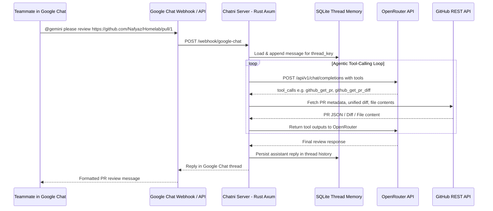

# Chatni: Google Chat AI Teammate (Rust + Axum + OpenRouter)

## Overview
**Chatni** is a self-hostable Rust (`axum`) service that acts like a remote software engineering teammate inside Google Chat. When mentioned in a space or DM (e.g., `@gemini, please review the pr https://github.com/Nafyaz/Homelab/pull/1`), Chatni loads the thread's conversation history from SQLite, runs an iterative tool-calling loop via **OpenRouter**, inspects GitHub PRs/diffs/files/comments, optionally submits reviews directly on GitHub, and replies naturally in the Google Chat thread.

---

## System Architecture

---

## Project Structure

- [`Cargo.toml`](Cargo.toml): Dependencies (`axum`, `tokio`, `reqwest`, `serde`, `serde_json`, `rusqlite`, `tokio-rusqlite` or `sqlx`, `tracing`, `dotenvy`, `jsonwebtoken` for optional Google Service Account async replies).
- [`src/main.rs`](src/main.rs): Application entrypoint, router setup (`/health`, `/webhook/google-chat`), shared `AppState`.
- [`src/config.rs`](src/config.rs): Environment-driven configuration:
  - `OPENROUTER_API_KEY`, `OPENROUTER_MODEL` (default e.g. `google/gemini-2.5-pro` or `anthropic/claude-3.7-sonnet`)
  - `GITHUB_TOKEN` (fine-grained PAT for reading private/public repos and submitting PR reviews)
  - `GOOGLE_CHAT_VERIFICATION_TOKEN` / `GOOGLE_SERVICE_ACCOUNT_JSON` (optional for async follow-up messages beyond synchronous webhook response)
  - `DATABASE_URL` / `SQLITE_PATH`
- [`src/db.rs`](src/db.rs): SQLite persistence for Google Chat thread context (`thread_id`, `role`, `content`, `tool_calls`, `tool_call_id`, `created_at`).
- [`src/openrouter.rs`](src/openrouter.rs): OpenRouter Chat Completions client supporting tool definitions (`tools`), `tool_calls`, and `role: "tool"` messages.
- [`src/tools/mod.rs`](src/tools/mod.rs) & [`src/tools/github.rs`](src/tools/github.rs):
  - `github_get_pr`: Fetches PR title, body, author, branch refs, state, and changed files list (`GET /repos/{owner}/{repo}/pulls/{pull_number}` + `/files`).
  - `github_get_pr_diff`: Fetches the unified diff for the PR (`Accept: application/vnd.github.v3.diff`), with automatic truncation/filtering for huge diffs.
  - `github_get_file_content`: Fetches full source file at a specific git ref (`GET /repos/{owner}/{repo}/contents/{path}?ref={ref}`).
  - `github_list_pr_comments`: Lists existing issue & review comments on the PR.
  - `github_submit_pr_review`: Submits a formal GitHub PR review (`COMMENT`, `APPROVE`, `REQUEST_CHANGES`) with body and optional inline line comments (`POST /repos/{owner}/{repo}/pulls/{pull_number}/reviews`).
- [`src/agent.rs`](src/agent.rs): Multi-step agent loop (up to configurable `MAX_TOOL_ITERATIONS`, e.g., 10) with a concise teammate system prompt tailored for Google Chat formatting.
- [`src/google_chat.rs`](src/google_chat.rs):
  - Parses Google Chat event payloads (both Classic Hangouts Chat event format and Google Workspace Add-ons Chat format).
  - Strips the leading `@bot` mention cleanly while preserving URLs.
  - Supports both **synchronous HTTP reply** (fast setup, zero extra auth required, waits up to ~25s) and **asynchronous reply** via Google Chat REST API / Space Webhook when an operation takes longer.
- [`Dockerfile`](Dockerfile) & [`.env.example`](.env.example) & [`README.md`](README.md): Ready for deployment in a Homelab (Docker / Kubernetes / Cloudflare Tunnel / Tailscale Funnel).
